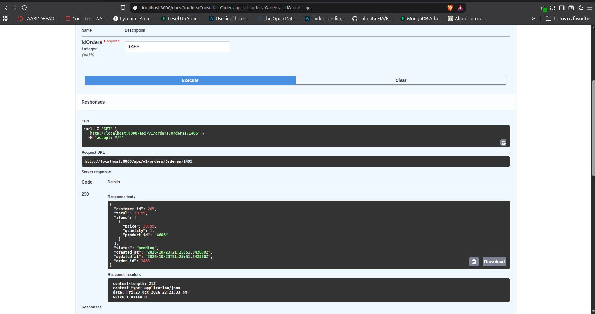
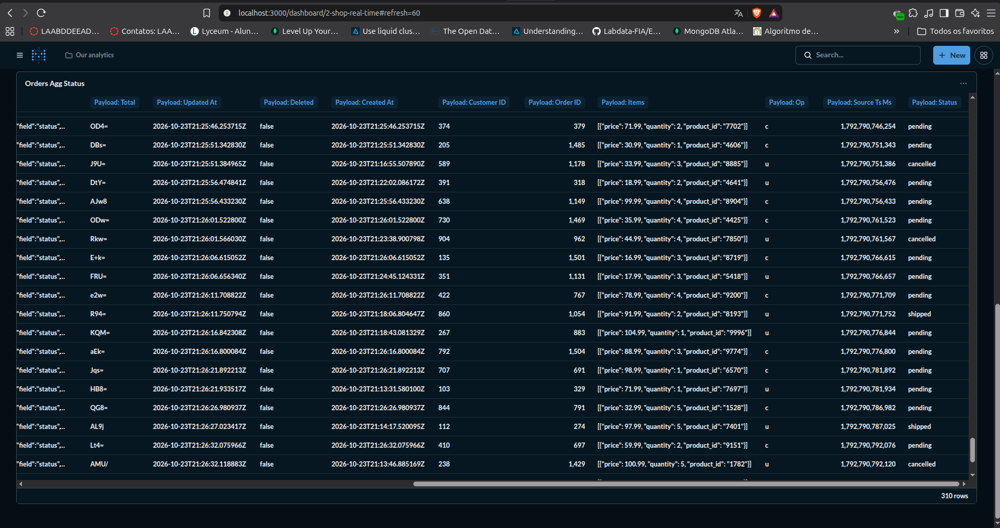
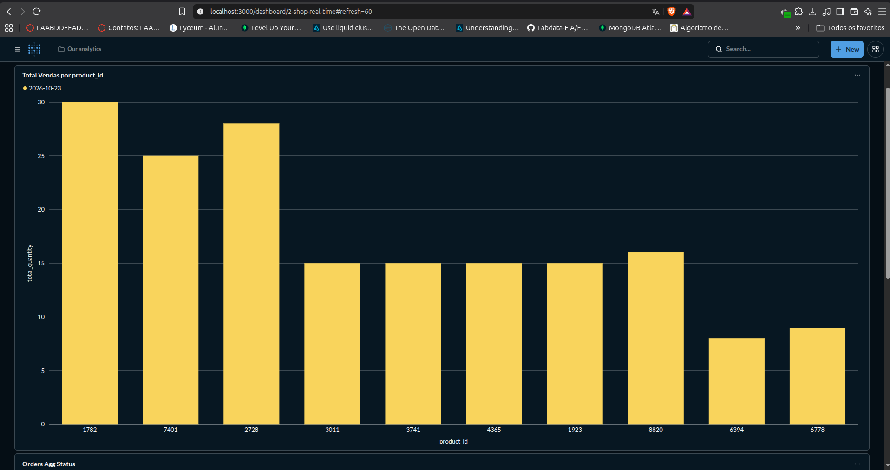

# shopvibe
ShopVibe: Ingestão de Dados em Tempo Real

---

# ADR-[20261020]: [Dados em Real Time]

* **Status:** [Proposto | Aceito | Rejeitado | Substituído]
* **Data:** [20/10/2026]
* **Autor(es):** [Matheus Rodrigues Hilario / Engenheiro de Dados]
* **Decisores:** [Matheus Rodrigues Hilario / Engenheiros envolvidos]

## Contexto
ShopVibe é um e-commerce fictício que perde vendas por não enxergar o que acontece na loja em tempo real. A missão é propor, documentar e demonstrar a ingestão em tempo real dos pedidos da loja. (ex: volume de dados, latência, custos, restrições de conformidade como LGPD/GDPR).

## Decisão
Decidimos usar o Kafka conect debezium por necessidade de baixissima latencia, alta vazão de volumetria e também pelo mesmo conseguir se conectar com o MinIO S3 e com o MongoDB, aqui estamos fazendo CDC pois sabemos que o banco de produção não aguentaria as regras de negócio inputadas direto na fonte, usamos aqui para fazer a replica para o tópico "pgserver.public.orders" onde conseguimos ler esses dados, também fazemos uso do schema-registry ou seja os metadados dos dados vão junto com a mensagem ou seja sabemos o tipo certo de cada campo (INT, STRING, FLOAT, TIMESTAMP), fazemos o sink com o MinIO S3 e MongoDB com replicaSet habilitado ou seja podemos usar um Metabase para criar as visualizações e criamos uma API FastAPI Async para consumo de dados com documentação (Swagger e Redoc)

---

---

## Consequências
Quais são os impactos (positivos e negativos) decorrentes desta decisão?
Impacto positivo: Ao ler a cada 400 ms conseguimos ir no detalhe da operação ou seja o que cada cliente compra além de saber o total de produtos que temos no estoque e repor os produtos antes de acabar.

Impacto negativo: Necessita grana e gente capacitada para dar manutenção nos topicos e partitions do Kafka, além de criar rotinas de manutenção pois terá problemas de small files na camada bronze e o custo de nuvem pois será 24/7 fazendo CDC direto do banco de produção. 

### Positivas (Prós)
* Arquitetura permite o uso tanto em cloud quanto on-premise permitindo escalar quando necessario.
* Uso de CDC já facilita saber o que mudou a cada minuto além de saber o que está ocorrendo no site/app.
  MongoDB com replicaSet habilitado evita perda de dados e facilita a questão da consulta usando Dashboard no Metabase.

### Negativas / Riscos (Contras)
* Necessita profissionais capacitados nas seguintes tecnologias (Apache Kafka/Kafka Conect Debezium, MongoDB, programação em python/FastAPI)
* Necessidade de ativação do WAL_LEVEL log no Postgres de Produção para habilitar o uso do CDC

---

---

## Alternativas Consideradas
1. **[Alternativa A]:** Poderíamos ter escolhido o Spark Streaming lendo direto do tópico kafka sem usar Kafka conect o motivo seria temos engenheiros capacitados para usar e escrever código Spark e temos um ecossistema bem robusto e usado além da comunidade sempre ajudando ou seja o único motivo pelo qual não decidimos escolher o Spark foi em termos de custo pois exigiria mais um cluster/VM habilitada 24/7 lendo os topicos em NRT ou real time e gravando isso direto no Minio camada silver ou jogando as visões para um banco de dados coluna como o MariaDB ColumnStore.

2. **[Alternativa B]:** Uso do MariaDB ColumnStore ao invés do MongoDB o real motivo falta de pessoal capacitado para manutenção dos cluster MariaDB ColumnStore habilitado lendo direto do Minio com arquivos em .parquet essa configuração exige alto conhecimento técnico e vemos no mercado pessoas seguindo a linha de software mais corporativo como o SQL Server ou Oracle o que diminui ainda mais a safra de pessoas habilitadas para execução e dar manutenção a médio/longo prazo. Por isso não seguimos com essa linha.

3. **[Alternativa C]:** Uso do ksqlDB mostrando as visões agregados dos produtos e totais de vendas jogando este resultado numa camada silver ou tombando direto no MongoDB, administrar o cluster, configurar e encontrar gente no perfil para rodar os scripts e condensar o resultado no MongoDB fez com que a gente optasse pela solução disposta no vídeo. 

---

---